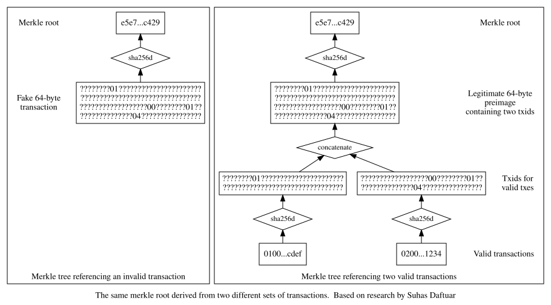

Le bulletin de cette semaine signale une vulnérabilité dans des versions de Bitcoin Core ayant déjà dépassé leur fin de vie, demande de
l'aide pour tester les versions candidates de la prochaine version majeure de Bitcoin Core, fournit une mise à jour sur la liste de
diffusion Bitcoin-Dev, décrit les discussions récentes de cette liste et renvoie vers un chapitre sur le traitement par lots des paiements
dans le livre en cours de rédaction d'Optech sur les techniques de passage à l'échelle. Sont également incluses des descriptions de
plusieurs commits notables dans des projets populaires d'infrastructure Bitcoin.

## Mesures à prendre

- **Assurez-vous que vous n'utilisez pas d'anciennes versions de Bitcoin Core :** Suhas Daftuar a divulgué une vulnérabilité affectant
  Bitcoin Core 0.13.0 à 0.13.2. (Note : ces versions avaient dépassé leur [fin de vie][core eol] depuis plusieurs mois.) La vulnérabilité
  permettrait à un attaquant de convaincre votre nœud qu'un bloc valide était invalide, vous séparant par fork de la chaîne de blocs de
  consensus et rendant possible de vous faire croire que vous aviez reçu des bitcoins confirmés que vous ne contrôleriez pas réellement. En
  plus de vérifier la présence d'anciennes versions de Bitcoin Core dans votre infrastructure, il est également recommandé de vérifier les
  altcoins dont les nœuds sont basés sur les versions affectées de Bitcoin Core. Voir les détails de la divulgation ci-dessous pour plus
  d'informations.

- **Aidez à tester Bitcoin Core 0.18.0 RC1 :** la première Release Candidate (RC) de la prochaine version majeure de Bitcoin Core a été
  publiée. Les organisations et utilisateurs expérimentés qui dépendent de Bitcoin Core sont fortement encouragés à le [tester][0.18.0] afin
  de détecter les régressions et autres problèmes qui pourraient affecter son utilisation en production. Tout test est apprécié, mais si
  vous avez un peu de temps supplémentaire après avoir testé vos cas d'utilisation spécifiques, veuillez envisager d'aider à tester les
  [changements de la 0.18][gui 0.18] dans l'interface graphique. Cette interface est principalement utilisée par des utilisateurs moins
  expérimentés qui sont peu susceptibles de tester eux-mêmes les RC mais qui seraient particulièrement affectés par les problèmes qui
  passeraient au travers.

## Nouvelles

- **Mise à jour sur l'état de la liste de diffusion Bitcoin-Dev :** l'interruption du service signalée dans le [bulletin de la semaine
  dernière][le bulletin #36 ml] a été résolue mais les administrateurs de la liste [prévoient][bishop list] de migrer vers une autre
  solution. De nombreux messages envoyés au cours des deux dernières semaines ont été relayés aux abonnés de la liste, mais certains ont été
  perdus. Si vous ne voyez pas votre message dans les archives de [février][list feb] ou de [mars][list mar], veuillez le renvoyer. Les
  prochains bulletins d'Optech mentionneront toute action que les abonnés à la liste devront entreprendre afin de continuer à recevoir les
  discussions sur le protocole.

- **Divulgation d'une vulnérabilité de Bitcoin Core :** Suhas Daftuar a [divulgué][merkle disclosure] une nouvelle méthode pour tromper les
  versions antérieures de Bitcoin Core afin qu'elles rejettent des blocs valides. Si un attaquant créait un bloc avec deux transactions dont
  les hachages de 32 octets (txids), une fois concaténés, ressemblent à une transaction de 64 octets, il est possible de créer deux
  interprétations différentes de l'arbre de Merkle enraciné dans l'en-tête du bloc---l'une où l'arbre pointe vers une seule transaction
  invalide de 64 octets et l'autre où il pointe vers deux transactions valides. (Des versions conflictuelles similaires peuvent également
  être créées avec plus de deux transactions.)

  

  Cela peut créer un problème pour Bitcoin Core car, normalement, s'il rejette un bloc comme étant invalide, il ajoutera le hachage
  d'en-tête de ce bloc à un cache afin de ne pas gaspiller de ressources à redemander ou retraiter ce bloc. Cela permettait à un attaquant
  d'envoyer à votre nœud la forme invalide du bloc afin d'empêcher ensuite votre nœud de traiter sa forme valide ou tout bloc qui en
  descend, vous séparant de la chaîne.

  Une vulnérabilité similaire avait été divulguée en 2012 sous le nom de [CVE-2012-2459][] et Bitcoin Core avait alors été adapté pour ne
  pas mettre en cache l'invalidité des blocs dont l'arbre de Merkle contient des ambiguïtés. Cependant, une [optimisation][bitcoin core
  #7225] implémentée dans Bitcoin Core 0.13.0 a réintroduit ce problème de mise en cache et nécessité un [correctif][bitcoin core #9765],
  qui a été inclus dans Bitcoin Core 0.14.0. L'e-mail de Daftuar inclut un [PDF très instructif][daftuar pdf] qui non seulement décrit ce
  problème spécifique en détail et montre que son coût n'est que de 30 bits de travail par force brute (bien qu'il faille également miner un
  bloc personnalisé) mais qui décrit aussi d'autres vulnérabilités connues possibles avec les arbres de Merkle de Bitcoin et calcule la
  quantité moyenne de travail par force brute nécessaire pour les exploiter. Daftuar n'a trouvé à ce jour aucune occurrence de cette attaque
  dans l'actuelle chaîne de blocs de consensus.

- **Discussion sur la proposition de soft fork de nettoyage :** cette semaine a vu une discussion à propos de la [proposition][bip-cleanup]
  de soft fork de nettoyage décrite dans le [bulletin de la semaine dernière][le bulletin #36 cleanup]. Russell O'Connor a [soulevé la
  préoccupation][roconnor codesep] selon laquelle l'invalidation de l'opcode `OP_CODESEPARATOR` pourrait empêcher la dépense d'UTXOs
  existants utilisant cet opcode. Il n'est pas possible de détecter cela parce que des personnes pourraient avoir payé de l'argent à une
  adresse P2SH dont le redeemScript pas encore révélé utilise cet opcode déconseillé. O'Connor propose d'atténuer le problème de
  l'utilisation de `OP_CODESEPARATOR` pour augmenter le temps de vérification maximal d'un bloc en augmentant plutôt le poids (vbytes) des
  transactions dont les scripts évalués contiennent cet opcode. Cela réduirait le nombre maximal de séparateurs de code qui pourraient être
  contenus dans un bloc tout en réduisant probablement aussi la taille globale et le nombre total d'opérations dans le bloc au point qu'il
  puisse être vérifié dans un délai raisonnable.

  O'Connor a également soulevé une [préoccupation similaire][roconnor sighash] concernant la proposition du soft fork d'invalider les octets
  de type sighash non alloués. Il n'est pas non plus possible de détecter cela entièrement parce que des utilisateurs de Bitcoin peuvent
  avoir créé des transactions pré-signées avec locktime pour lesquelles ils ont perdu ou détruit les clés de signature, les empêchant de
  créer de nouvelles signatures. Au lieu d'augmenter le poids des octets de sighash non alloués pour restreindre leur utilisation, il
  recommande l'utilisation d'un cache sighash plus complexe (comme précédemment décrit comme option dans le BIP proposé).

  Matt Corallo a répondu aux deux préoccupations d'O'Connor en soulignant que, bien que nous ne puissions pas détecter l'utilisation de ces
  fonctionnalités pour des dépenses qui n'ont pas été diffusées, nous pouvons les détecter pour toutes les transactions de la chaîne
  existante---et que cette utilisation n'existe pas. « Je suis sérieusement sceptique à l'idée que quelqu'un utilise un schéma hautement
  ésotérique et y verse simplement de l'argent sans jamais l'avoir testé ni retiré le moindre argent », a déclaré Corallo avant de discuter
  également de la quantité de complexité supplémentaire nécessaire pour calculer les frais et mettre en cache les sighashes si ces
  fonctionnalités ne sont pas désactivées. Sa réfutation comprenait également un appel à quiconque utilise des fonctionnalités de
  transaction qui ne sont ni relayées ni minées par défaut (« non standard ») à [contacter][core contact] les développeurs de Bitcoin Core
  et à les informer de la situation afin que les politiques puissent être réexaminées.

- **Retours demandés sur signet :** Karl-Johan Alm travaille sur une [alternative][signet] au testnet de Bitcoin qui utilise des blocs
  signés de manière centralisée au lieu d'une preuve de travail. Bien que cela ne permette pas de tester la nature décentralisée de Bitcoin,
  cela pourrait rendre le réseau de test beaucoup plus pratique pour les développeurs d'applications en fournissant une production régulière
  de blocs la plupart du temps ainsi que des tests planifiés d'événements défavorables tels que des réorganisations de la chaîne de blocs ou
  des pics de frais. Cela garantirait également que l'autorité centrale de signature dispose toujours de pièces de test à distribuer via son
  faucet. En comparaison, la production de blocs sur le testnet est parfois trop rapide pour que les pairs puissent suivre ou si lente
  qu'elle est inutile pour les tests, les faucets sont souvent vides, et des perturbateurs peuvent créer des scénarios de réorganisation qui
  seraient extrêmement peu probables sur un réseau où une valeur réelle est en jeu. Alm cherche des retours et aimerait éventuellement
  intégrer son code dans Bitcoin Core (et, probablement, faire en sorte que d'autres implémentations de nœud le prennent aussi en charge).

- **Suppression des messages P2P `reject` de BIP61 :** Marco Falke a lancé un [fil][falke bip61] afin d'obtenir des retours sur son souhait
  de supprimer les messages `reject` de [BIP61][] de Bitcoin Core. Lorsque votre nœud reçoit un message (comme une transaction) qui présente
  un problème, votre nœud renverra un message `reject` contenant une description du problème. Les messages BIP61 ne sont pas trustless
  (votre nœud pourrait mentir) et les mêmes informations sur les problèmes peuvent être extraites des journaux du nœud qui rejette, ce qui
  permet aux développeurs d'enquêter sur les problèmes avec les messages envoyés à leurs propres nœuds. Voir le [Bulletin #13][le bulletin
  #13] pour notre description de la PR de Falke qui a désactivé les messages `reject` par défaut dans Bitcoin Core.

  Andreas Schildbach, auteur de portefeuille et principal mainteneur de la populaire bibliothèque BitcoinJ, a demandé à conserver les
  messages et à les réactiver par défaut. Ses utilisateurs lui envoient par e-mail des fichiers journaux contenant des messages reject
  lorsque leurs transactions ne passent pas, ce qui l'aide à déboguer les problèmes. En réponse, Gregory Maxwell a souligné que même
  lorsqu'un nœud honnête accepte une transaction, cela ne signifie pas qu'elle sera également acceptée par les pairs de ce nœud. Cela
  signifie que les clients doivent toujours surveiller la propagation des transactions sans utiliser BIP61, ce qui rend BIP61 redondant à
  cette fin. De même, BIP61 ne peut pas raisonnablement être utilisé pour détecter les transactions avec des taux de frais trop faibles car
  une transaction acceptée payant un taux de frais minimal peut prendre des semaines de plus à se confirmer que ce que l'utilisateur
  souhaitait lorsque les mempools de taille par défaut sont pleins. Enfin, les nœuds de vérification sont conçus pour maximiser les
  performances, ce qui entre souvent en conflit avec la capacité à fournir des informations de débogage les plus utiles possibles à des
  pairs aléatoires non fiables.

- **Champs d'extension pour les Partially Signed Bitcoin Transactions (PSBTs) :** Andrew Poelstra a [proposé][psbt extension] l'ajout de
  plusieurs champs aux PSBTs pour aider à prendre en charge plusieurs nouvelles fonctionnalités. Il a également proposé de rendre optionnel
  un champ actuellement requis. Ces nouveaux champs peuvent aider les clients à déterminer si une condition `OP_CHECKSEQUENCEVERIFY` (CSV)
  est satisfaite, prendre en charge toute la gamme des scripts qu'il est possible de générer avec [miniscript][], et inclure des données
  supplémentaires pour une utilisation avec les protocoles [MuSig][], pay-to-contract et sign-to-contract. L'auteur de [BIP174][], Andrew
  Chow, s'est montré réceptif à la plupart des suggestions.

- **Publication d'une revue de la littérature sur la confidentialité de Bitcoin :** Chris Belcher a publié un [résumé][privacy summary]
  étendu de diverses préoccupations en matière de confidentialité présentes dans Bitcoin. Cette page et la [catégorie Privacy][privacy
  category] associée du Wiki constituent un excellent point de départ pour quiconque étudie les questions de confidentialité dans Bitcoin.

- **Proposition de message `addr` version 2 :** Wladimir van der Laan a [proposé][addrv2 proposal] la création d'un BIP pour une nouvelle
  version du message `addr` du protocole P2P. Le message existant communique l'adresse IP ou le nom de service caché Tor (.onion) encodé en
  [OnionCat][] d'un nœud, son port et une bitmap des services fournis par le nœud. Cependant, depuis la publication de la base de code
  originale de Bitcoin, Tor a mis à niveau ses adresses de services cachés pour utiliser 256 bits, empêchant leur utilisation dans les
  messages `addr` existants de Bitcoin. Il existe également d'autres protocoles de superposition réseau, tels qu'I2P, qui utilisent eux
  aussi des adresses plus longues. Le BIP proposé, s'il est implémenté, fournira une prise en charge de ces protocoles.

- **Optech publie un chapitre de livre sur le traitement par lots des paiements :** payer plusieurs personnes dans une même transaction peut
  réduire le coût moyen des frais de transaction par paiement de plus de 70 %. Cette technique est particulièrement pratique pour les
  dépensiers à haute fréquence tels que les plateformes d'échange. Dans le cadre du travail en cours d'Optech pour créer un guide sur les
  techniques de passage à l'échelle déployables individuellement, nous publions notre [brouillon de chapitre][batching chapter] qui décrit
  cette technique et ses compromis en détail.

## Changements notables dans le code et la documentation

*Changements notables cette semaine dans [Bitcoin Core][bitcoin core repo], [LND][lnd repo], [C-Lightning][c-lightning repo],
[Eclair][eclair repo], [libsecp256k1][libsecp256k1 repo] et [Bitcoin Improvement Proposals (BIPs)][bips repo]. Notez que Bitcoin Core fait
actuellement l'objet de travaux à la fois sur sa branche de développement master et sur la branche de la prochaine version 0.18, nous avons
donc indiqué quelle branche était affectée par chaque fusion de Bitcoin Core.*

- [Bitcoin Core #15118][] généralise la manière dont Bitcoin Core stocke et récupère les données associées aux blocs et aux changements
  d'UTXO afin de faciliter pour de nouvelles méthodes le stockage et la récupération d'autres informations de la même manière. Cela a été
  fait pour permettre la réutilisation de ce mécanisme pour stocker sur disque les filtres compacts de blocs [BIP157][]. Cela fait
  actuellement partie uniquement de la branche de développement master.

- [Bitcoin Core #15492][] supprime le RPC obsolète `generate` utilisé pour créer des blocs en mode regtest. Ce RPC avait auparavant été
  remplacé par le RPC `generatetoaddress` qui ne nécessite pas que le nœud soit compilé ou exécuté avec la prise en charge du portefeuille.
  Cela fait partie uniquement de la branche de développement master.

- [Bitcoin Core #15497][] modifie l'utilisation des [descripteurs de script de sortie][output script descriptors] dans plusieurs RPCs afin
  d'utiliser une notation de plage cohérente pour dériver plusieurs adresses à partir d'un descripteur avec un chemin de portefeuille HD
  [BIP32][]. Cela fait partie de la branche 0.18 et de la version 0.18.0RC1.

- [LND #2690][] place davantage de trafic gossip dans une file d'attente (plutôt que de l'envoyer immédiatement) afin que les informations
  de priorité plus élevée aient plus de chances d'être traitées rapidement. Le trafic gossip est utilisé pour communiquer quels pairs sont
  sur le réseau et quels canaux ils ont disponibles.

- [C-Lightning #2391][] déprécie le champ `address` dans le RPC `newaddr`, en le remplaçant soit par un champ `bech32`, soit par un champ
  `p2sh-segwit` selon le type d'adresse demandé (ou les deux champs si un paramètre optionnel `all` est passé au RPC). Le type d'adresse
  dans chaque champ est cohérent avec son nom.



[core eol]: https://bitcoincore.org/en/lifecycle/#schedule
[0.18.0]: https://bitcoincore.org/bin/bitcoin-core-0.18.0/
[bishop list]: https://gnusha.org/url/https://lists.linuxfoundation.org/pipermail/bitcoin-dev/2019-March/016700.html
[merkle disclosure]: https://gnusha.org/url/https://lists.linuxfoundation.org/pipermail/bitcoin-dev/2019-February/016697.html
[list feb]: https://gnusha.org/url/https://lists.linuxfoundation.org/pipermail/bitcoin-dev/2019-February/date.html
[list mar]: https://gnusha.org/url/https://lists.linuxfoundation.org/pipermail/bitcoin-dev/2019-March/date.html
[daftuar pdf]: https://gnusha.org/pi/bitcoindev/CAFp6fsGtEm9p-ZQF_XqfqyQGzZK7BS2SNp2z680QBsJiFDraEA@mail.gmail.com/2-BitcoinMerkle.pdf
[roconnor codesep]: https://gnusha.org/url/https://lists.linuxfoundation.org/pipermail/bitcoin-dev/2019-March/016724.html
[roconnor sighash]: https://gnusha.org/url/https://lists.linuxfoundation.org/pipermail/bitcoin-dev/2019-March/016725.html
[core contact]: https://bitcoincore.org/en/contact/
[signet]: https://gnusha.org/url/https://lists.linuxfoundation.org/pipermail/bitcoin-dev/2019-March/016734.html
[falke bip61]: https://gnusha.org/url/https://lists.linuxfoundation.org/pipermail/bitcoin-dev/2019-March/016701.html
[bip-cleanup]: https://github.com/TheBlueMatt/bips/blob/cleanup-softfork/bip-XXXX.mediawiki
[psbt extension]: https://gnusha.org/url/https://lists.linuxfoundation.org/pipermail/bitcoin-dev/2019-March/016713.html
[privacy summary]: https://en.bitcoin.it/wiki/Privacy
[privacy category]: https://en.bitcoin.it/wiki/Category:Privacy
[addrv2 proposal]: https://gnusha.org/url/https://lists.linuxfoundation.org/pipermail/bitcoin-dev/2019-February/016687.html
[onioncat]: https://web.archive.org/web/20121122003543/http://www.cypherpunk.at/onioncat/wiki/OnionCat
[batching chapter]: /en/payment-batching/
[gui 0.18]: https://github.com/bitcoin/bitcoin/pulls?utf8=%E2%9C%93&q=is%3Apr+label%3AGUI+milestone%3A0.18.0
[le bulletin #36 ml]: /en/newsletters/2019/03/05/#bitcoin-dev-mailing-list-outage
[le bulletin #36 cleanup]: /en/newsletters/2019/03/05/#cleanup-soft-fork-proposal
[le bulletin #13]: /fr/newsletters/2018/09/18/#bitcoin-core-14054
[cve-2012-2459]: https://bitcointalk.org/?topic=102395
[miniscript]: /en/topics/miniscript/
[musig]: https://eprint.iacr.org/2018/068
[output script descriptors]: https://github.com/bitcoin/bitcoin/blob/master/doc/descriptors.md
