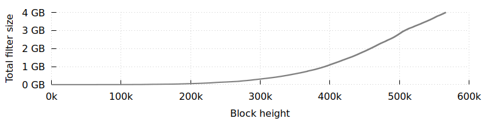

Le bulletin de cette semaine annonce la sortie de LND 0.6-beta et la fusion du support de BIP158 dans la branche de développement de Bitcoin
Core. Sont également inclus les sections habituelles sur le support d'envoi vers bech32 et les changements notables apportés aux projets
populaires d'infrastructure Bitcoin.



## Mesures à prendre

- **Aidez à tester les versions candidates de Bitcoin Core 0.18.0 :** la quatrième RC de Bitcoin Core pour sa prochaine version majeure est
  [disponible][0.18.0]. Cela résout plusieurs problèmes trouvés dans les versions précédentes et annule la fusion précédente d'une nouvelle
  fonctionnalité qui semblait causer des problèmes à une minorité de testeurs (voir la section *changements notables dans le code et la
  documentation* pour plus de détails). Les testeurs des RC ont déjà contribué à améliorer la qualité de la version finale et ceux qui
  essaient cette toute dernière RC aideront davantage à faire de la 0.18 la meilleure version de Bitcoin Core à ce jour. Veuillez utiliser
  [ce ticket][Bitcoin Core #15555] pour signaler vos retours.

## Nouvelles

- **LND 0.6-beta publié :** sept mois après la sortie de la 0.5-beta, cette [nouvelle version majeure][lnd 0.6-beta] apporte un grand nombre
  de changements notables. En tête de ces changements se trouvent les Static Channel Backups (SCB). Ceux-ci permettent aux utilisateurs de
  créer un unique fichier de sauvegarde à tout moment après l'ouverture d'un nouveau canal afin qu'ils puissent récupérer les fonds de ce
  canal et de tous les canaux précédemment ouverts en cas de perte de données (par exemple, un crash de disque dur). Le système n'est pas
  parfait---par exemple, l'argent stocké dans des HTLC non réglés au moment où les données ont été perdues ne peut actuellement pas être
  récupéré---mais il représente une amélioration majeure de la sécurité des sauvegardes LN et une base qui pourra être améliorée via des
  changements de protocole proposés et le support des watchtowers.

  Parmi les autres changements figurent plusieurs réductions majeures de l'utilisation de la mémoire et de la bande passante, ainsi qu'une
  fonctionnalité autopilot améliorée qui aide les utilisateurs à ouvrir automatiquement de nouveaux canaux pour le routage des paiements.
  Les binaires de publication ont également été construits avec tout le nécessaire pour être utilisés avec [Lightning Loop][] afin de
  déplacer sans confiance des fonds LN vers une adresse onchain sans fermer un canal.

  Pour plus d'informations, nous vous encourageons à lire les [notes de version][lnd 0.6-beta] complètes.

- **Support de base de BIP158 fusionné dans Bitcoin Core :** avec la [fusion][Bitcoin Core #14121] d'une PR de Jim Posen dans la branche
  principale de développement de Bitcoin Core, les utilisateurs peuvent désormais activer une nouvelle option de configuration
  `blockfilterindex` (désactivée par défaut) qui générera un filtre de bloc compact [BIP158][] pour chaque bloc de la chaîne ainsi que son
  en-tête de filtre correspondant nécessaire au support de [BIP157][] .[^fn-bip157-bip158] Cela fonctionnera en arrière-plan pendant que le
  programme continue par ailleurs de fonctionner normalement, en prenant environ une à trois heures sur la plupart des ordinateurs.
  L'utilisateur peut ensuite récupérer le filtre d'un bloc spécifique en utilisant le nouveau RPC `getblockfilter`. Les filtres pour
  l'ensemble de la chaîne de blocs utilisent actuellement environ 4 gigaoctets. Leur croissance au fil du temps peut être observée dans le
  graphique suivant :

  

  Ces filtres ne sont actuellement utilisés nulle part ailleurs dans le programme et ne sont pas exposés publiquement via l'implémentation
  par Bitcoin Core du protocole P2P. Une prochaine étape proposée pour les filtres qui semble bénéficier d'un large soutien parmi les
  développeurs de Bitcoin Core est de permettre au programme local d'utiliser les filtres pour scanner rapidement la chaîne de blocs à la
  recherche de transactions historiques. Par exemple, si vous déchargez un portefeuille dans le mode multiwallet de Bitcoin Core puis le
  rechargez plus tard, il doit examiner chaque bloc arrivé depuis qu'il a été déchargé pour voir si l'un d'eux contenait une transaction
  affectant le portefeuille. Avec les filtres, le portefeuille peut simplement vérifier d'abord les filtres, plus petits et plus rapides,
  puis n'examiner en détail que les blocs pour lesquels le filtre indique une correspondance possible avec des transactions du portefeuille.

## Bech32 sending support

*Week 6 of 24. Until the second anniversary of the segwit soft fork lock-in on 24 August 2019, the Optech le bulletin will contain this
weekly section that provides information to help developers and organizations implement bech32 sending support---the ability to pay native
segwit addresses. This [doesn't require implementing segwit][bech32 series] yourself, but it does allow the people you pay to access all of
segwit's multiple benefits.*

<!-- weekly reminder for harding: check Bech32 Adoption
wiki page for changes -->


{{ bech32_section
  | replace: "/en/newsletters/", "/fr/newsletters/"
  | replace: "/fr/newsletters/2019/03/19/#bech32-sending-support",
             "/fr/newsletters/2019/03/19/#prise-en-charge-de-lenvoi-vers-bech32"
}}

## Changements notables dans le code et la documentation

*Changements notables cette semaine dans [Bitcoin Core][bitcoin core repo], [LND][lnd repo], [C-Lightning][c-lightning repo],
[Eclair][eclair repo], [libsecp256k1][libsecp256k1 repo], et [Bitcoin Improvement Proposals (BIPs)][bips repo]. Note : sauf indication
contraire, toutes les fusions décrites pour Bitcoin Core concernent sa branche principale de développement ; certaines peuvent également
être rétroportées vers sa version en attente de publication.*

- [Bitcoin Core #15839][] annule [#14897][Bitcoin Core #14897] dans la branche 0.18 uniquement (pas dans la branche principale de
  développement). Voir la section *changements notables dans le code et la documentation* du [Bulletin #33][le bulletin #33] pour notre description
  détaillée de #14897, qui a été fusionnée début février. Plusieurs testeurs attentifs des versions candidates (RC) de la 0.18.0 ont
  remarqué que leur nœud cessait parfois de demander de nouvelles transactions peu après son démarrage. Ce problème intermittent semblait
  être lié à l'amélioration de la demande de transactions apportée dans #14897 afin de réduire le risque de déni de service. Au moins deux
  PR ([1][Bitcoin Core #15776], [2][Bitcoin Core #15834]) ont déjà été ouvertes pour tenter de résoudre le problème, mais un accord général
  s'est dégagé dans le projet pour retirer cette nouvelle fonctionnalité de la 0.18.0 afin qu'elle et ses correctifs puissent recevoir des
  tests supplémentaires dans la branche de développement avant leur publication dans une version de production. L'objectif du cycle RC est
  d'identifier des problèmes potentiels comme celui-ci avant qu'ils n'affectent les utilisateurs réguliers, nous pensons donc parler au nom
  de ces utilisateurs en remerciant toutes les personnes impliquées dans les tests jusqu'à présent.

- [Bitcoin Core #15557][] améliore les fonctions sous-jacentes derrière le RPC `bumpfee` et l'option de menu équivalente dans l'interface
  graphique afin d'inclure des entrées supplémentaires si l'augmentation des frais ne peut pas être payée simplement en diminuant la valeur
  d'une sortie de monnaie rendue existante. Cela élimine le [mode d'échec][rbf core fail] de Bitcoin Core décrit dans l'[étude
  d'utilisabilité RBF][rbf usability study] d'Optech et permet ainsi aux augmentations de frais effectuées par les utilisateurs de Bitcoin
  Core de réussir plus souvent.

- [C-Lightning #2541][], [#2545][c-lightning
  #2545], et [#2546][c-lightning #2546] implémentent de multiples changements du
  sous-système de gossip utilisé pour suivre quels canaux sont disponibles et calculer des routes à travers eux. Ce travail a été motivé par
  le [projet d'un million de canaux][million channels project] et les résultats de performance de ce projet sont inclus dans de nombreux
  messages de commit. Si Optech interprète correctement les résultats, la différence entre le [premier commit][417e1ba] de la série et le
  [dernier commit][0fc4241] est une réduction de 79 % de l'utilisation mémoire, passant de 2,6 Gio à 0,6 Gio, et une réduction de 80 % du
  temps nécessaire pour construire une route vers un nœud sélectionné aléatoirement (dans une limite de 20 sauts), passant de 60 secondes à
  12 secondes. (Si même les valeurs améliorées semblent élevées, rappelez-vous qu'il s'agit d'un réseau de simulation de plus de 25 fois la
  taille du réseau mainnet actuel et 1 000 fois la taille du réseau d'il y a un peu plus d'un an.) Une partie notable de ce changement est
  le passage de C-Lightning de son algorithme de routage assez unique [Bellman--Ford--Gibson (BFG)][bfg post] à une version [légèrement
  personnalisée][e197956] de [Dijkstra][].

- [Eclair #885][] ajoute un unique identifiant de type UUID pour suivre les paiements indépendamment des HTLC utilisés en relation avec eux,
  permettant un suivi simplifié du succès ou de l'échec final du paiement lui-même. Cela traite le cas où le programme réessaie
  automatiquement d'envoyer un paiement temporairement échoué en utilisant une route différente et génère donc des échecs non finaux et
  d'autres informations qui peuvent ne pas être utiles à un consommateur d'API de haut niveau. Bien qu'il existe des différences
  d'implémentation et de motivation, cela semble conceptuellement lié à [C-Lightning #2382][] comme décrit dans la section *changements
  notables dans le code et la documentation* du [Bulletin #36][le bulletin #36].

- [Eclair #951][] implémente un mécanisme de sauvegarde de canal et fournit une [documentation][eclair backup] pour l'utiliser.
  Contrairement aux sauvegardes statiques de canaux de LND décrites plus haut dans ce bulletin, cela doit être sauvegardé après chaque
  paiement. Une option de configuration permet à Eclair d'appeler un script que vous spécifiez pour gérer automatiquement la sauvegarde du
  fichier de données chaque fois qu'une sauvegarde est nécessaire.

- [Eclair #927][] ajoute le support pour les plugins écrits en Scala, Java ou dans un langage compatible avec la JVM. Les plugins sont des
  implémentations de l'[interface de plugin][eclair plugin interface]. Voir la [documentation][eclair plugin doc] nouvellement ajoutée pour
  plus de détails.

## Footnotes

[^fn-bip157-bip158]:
    [BIP158][] introduit les _filtres de blocs compacts_, qui reposent sur une méthode efficace pour encoder une liste
    d'éléments de taille égale. Dans le cas des filtres de bloc « basiques » décrits dans le BIP, il s'agit d'une liste de tous les
    scriptPubKeys de sorties dépensables du bloc courant ainsi que de tous les scriptPubKeys des sorties dépensées par les entrées de ce bloc
    (ce que les développeurs appellent les sorties précédentes (prevouts)). Chacun des scriptPubKeys est haché afin que chaque élément ait la
    même taille, puis ces éléments sont triés dans une liste dont les éléments dupliqués sont retirés. Cette liste est ensuite encodée en
    utilisant l'algorithme [Golomb--Rice Coded Sets][gcs] (GCS) également décrit dans BIP158, réduisant sans perte la taille de la liste. Ce
    filtre basique spécifique fournit suffisamment d'informations pour que quiconque connaît une adresse Bitcoin puisse trouver tout bloc
    contenant une transaction payant cette adresse (scriptPubKey de sortie) ou dépensant des fonds précédemment reçus sur cette adresse
    (scriptPubKey de prevout). La recherche peut produire des correspondances faussement positives (ainsi des blocs ne contenant pas de
    transactions pour cette adresse seront inclus dans les résultats), mais ne produira jamais de faux négatifs (ainsi les blocs qui contiennent
    effectivement des transactions pour cette adresse ne seront jamais omis des résultats).

    Un BIP distinct, [BIP157][], décrit comment ces filtres de blocs compacts peuvent être servis sur le réseau en utilisant le protocole
    Bitcoin P2P. BIP157 est conçu pour fonctionner avec les filtres « basiques » de BIP158 mais il peut aussi être étendu pour supporter des
    filtres supplémentaires qui encodent des listes d'autres éléments. Une partie particulièrement remarquable de BIP157 est qu'il introduit
    le concept des *en-têtes de filtres* où l'en-tête de chaque filtre engage vers un hachage de l'en-tête de filtre du bloc précédent plus
    un hachage du filtre courant. Cela crée une chaîne de filtres similaire à la chaîne de blocs de Bitcoin et est conçu pour faciliter la
    comparaison des filtres provenant de plusieurs pairs : chaque pair peut envoyer uniquement l'en-tête de filtre (32 octets) et, s'il
    existe des en-têtes qui ne correspondent pas, le client peut demander des en-têtes de plus en plus anciens dans la chaîne jusqu'à ce que
    le point de divergence soit trouvé. Générer à la demande un en-tête de filtre pour un bloc particulier nécessiterait de hacher tous les
    filtres précédents, donc même si l'implémentation de Bitcoin Core ne supporte pas actuellement BIP157, elle stocke tout de même ces
    en-têtes sur disque pour un usage futur potentiel. Lors de la récupération d'un filtre en utilisant le nouveau RPC `getblockfilter`, à
    la fois le filtre BIP158 et l'en-tête BIP157 sont renvoyés :

    ```text
    $ bitcoin-cli getblockfilter $( bitcoin-cli getblockhash 170 )
    {
      "filter": "0357e49590040c79b0",
      "header": "349eaecc8bb7793c9f3c28e78df6675ef904515e9a310e4532785aeb45526090"
    }
    ```

    Nous avons sélectionné le bloc 170 parce que son filtre est le premier à contenir plus d'un élément (il contient 3 éléments) et parce
    que le dernier bloc au moment de la rédaction (bloc 572,879) possède un filtre qui contient 8 599 éléments---bien trop pour que nous
    puissions l'imprimer élégamment.


[0.18.0]: https://bitcoincore.org/bin/bitcoin-core-0.18.0/
[bech32 series]: /en/bech32-sending-support/
[rbf core fail]: /en/rbf-in-the-wild/#bitcoin-core-increase-transaction-fee-almost
[million channels project]: https://github.com/rustyrussell/million-channels-project
[bfg post]: https://medium.com/@rusty_lightning/routing-dijkstra-bellman-ford-and-bfg-7715840f004
[dijkstra]: https://en.wikipedia.org/wiki/Dijkstra's_algorithm
[417e1ba]: https://github.com/ElementsProject/lightning/commit/417e1bab7d58f05aebb72825063e97b09fb8a6b9
[0fc4241]: https://github.com/ElementsProject/lightning/commit/0fc42415c24c12634b7e219ef80faf0223225c96
[e197956]: https://github.com/ElementsProject/lightning/commit/e197956032ec68470644766f52f9e50470b66a1c
[eclair backup]: https://github.com/ACINQ/eclair/#backup
[eclair plugin interface]: https://github.com/ACINQ/eclair/blob/master/eclair-node/src/main/scala/fr/acinq/eclair/Plugin.scala
[eclair plugin doc]: https://github.com/ACINQ/eclair#plugins
[lnd 0.6-beta]: https://github.com/lightningnetwork/lnd/releases/tag/v0.6-beta
[lightning loop]: https://github.com/lightninglabs/loop
[rbf usability study]: /en/rbf-in-the-wild/
[gcs]:  https://en.wikipedia.org/wiki/Golomb_coding#Rice_coding
[le bulletin #33]: /fr/newsletters/2019/02/12/#bitcoin-core-14897
[le bulletin #36]: /fr/newsletters/2019/03/05/#c-lightning-2382
